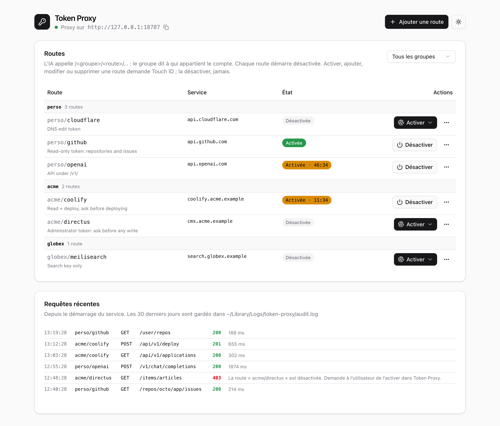
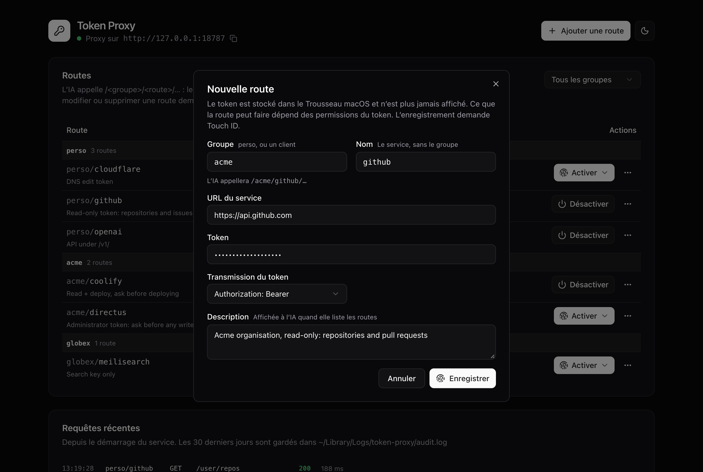

# Token Proxy

A local proxy for macOS that adds API tokens to requests, so AI agents (Claude Code, Codex, Cursor, scripts…) can call your services **without ever seeing a token**.

```
agent ──► http://127.0.0.1:8787/acme/coolify/api/v1/applications
            │  is route "coolify" of group "acme" enabled?
            │  + Authorization: Bearer <token from the Keychain>
            ▼
          https://coolify.acme.example/api/v1/applications
```

<picture>
  <source media="(prefers-color-scheme: dark)" srcset="docs/screenshots/dashboard-dark.png">
  
</picture>

> The admin UI is in English and French: it follows your browser language and has a switcher. Admin API errors and Touch ID prompts follow the macOS language (French, or English otherwise; `TOKEN_PROXY_LANG=en` or `fr` overrides it). What the agent reads on the proxy port is always in English. The screenshots show demo data.

## Why

An agent that calls an API needs a credential. Pasting it into the chat, an `.env` file or a shell variable puts it in the agent's context, its logs and its provider's servers. A prompt injection can then make the agent send the token elsewhere.

Token Proxy keeps the tokens in the macOS Keychain and adds them to requests itself. The agent only knows a local URL. You choose which routes are open and for how long, and every change that grants more access needs your Touch ID, which an agent cannot provide.

## How it works

- A **route** maps a local URL to a service: `http://127.0.0.1:8787/<group>/<route>/<path>` is forwarded to `<service URL>/<path>` with the token added, as `Authorization: Bearer`, a custom header (`x-api-key`…) or a query parameter (`access_token`…).
- A **group** says whose account a route uses: `perso` for your own, one group per client (`acme`, `globex`…). The URL always names the group, so an agent cannot use a client's account without naming the client. Two groups can each have a route with the same name, each with its own token.
- `GET http://127.0.0.1:8787/` lists the groups and routes for the agent: name, service URL, description and state. `GET /<group>/` lists one group. Tokens are never returned.
- The admin UI on `http://127.0.0.1:8788` adds, edits, enables and disables routes, and shows the latest requests.



## Security model

- **Touch ID for anything that grants access.** Adding, editing, deleting or enabling a route opens the macOS authentication dialog (Touch ID or the account password). The admin API is reachable by any local program, the agent included, but no program can complete that dialog. An agent may *ask* for a route to be enabled: approve only what you triggered yourself. Disabling never needs Touch ID.
- **Moving a token needs the token.** Editing a route keeps its token only while the token goes to the same place: changing the service's scheme, host or port, or how the token is sent (header, query parameter), is refused unless the token is pasted again. An agent that calls the admin API never has the token, so it cannot point a route elsewhere, even if you approve the dialog by mistake. The dialog shows each change as before → after.
- **https outside your network.** `http://` service URLs are refused except for local addresses (`localhost`, private and link-local IPs, `.local`), so a token never crosses the internet in clear.
- **Tokens stay in the Keychain.** All routes, tokens included, are stored in one Keychain item (`token-proxy` / `vault`). No file holds a secret, the APIs never return a token, and macOS asks you before any other program reads or changes that item. That prompt is the last barrier against an agent with a shell, which could rebuild or replace `~/.local/bin/token-proxy` and restart it: **a Keychain prompt you did not trigger yourself (by running `install.sh`) must be denied.**
- **Routes start disabled.** You enable a route for 15 minutes, 1 hour, 4 hours or until you disable it. Activations are stored in the Keychain too, so they survive a restart and no program can enable a route by editing a file. Editing a route disables it.
- **The token only goes to its service.** Credentials sent by the client (`Authorization`, `Cookie`, `x-api-key`) are dropped, redirects are not followed, and response headers that contain the token are removed.
- **Loopback only, local programs only.** Both ports listen on `127.0.0.1` only. Requests with an unexpected `Host` header are refused (DNS rebinding). On the proxy port, requests sent by a web page are refused (`Origin` or `Sec-Fetch-Site` headers), and CORS headers from services are removed, so a website open in your browser cannot use an enabled route. On the admin port, state-changing requests from another web origin are refused (CSRF).
- **Audit log.** Every request is written to `~/Library/Logs/token-proxy/audit.log` (route, method, path, status; never a token or a body), kept for 30 days. The UI shows the last 200 requests since the service started. It is a record, not proof: any program running as you can edit or delete the file.

## Limitations

Know them before you rely on it:

- **macOS only.** It depends on the Keychain, LocalAuthentication (Touch ID) and launchd.
- **The token's permissions are the only limit.** The proxy does not filter methods or paths: an enabled route lets the agent do everything the token allows. Use the narrowest token the service offers (read-only, one project), create a second route with another token for writes, and enable it only when needed.
- **A path in the service URL is not a restriction.** A route to `https://gitlab.com/api/v4/projects/42` stops `..` from climbing above that path, but the service may decode paths its own way (`%2F`…): the token can still reach everything it is allowed to. Restrict the token itself.
- **It protects the token, not access.** While a route is enabled, any program running as your user can call it: there is no client authentication on port 8787. Short activations limit that window.
- **Responses reach the agent.** Whatever the service answers goes to the agent and its provider. Only response headers are checked for the token, not bodies.
- **Query-parameter tokens can end up in upstream logs**, as with any URL token. Prefer header-based auth when the service supports it.
- **Not for shared machines or servers.** It is built for one person on one Mac.
- **Touch ID is only as good as your attention.** The dialog says what is being approved (for instance "enable the route “acme/coolify” (https://coolify.acme.example) for 15 min"): read it. Only one dialog is shown at a time, so an agent can keep it busy and delay your own approvals; it can never delay disabling, which needs none. Cancel a dialog you did not trigger.
- **No WebSockets**, request bodies up to 10 MB. Streamed responses (server-sent events) work.
- **Unsigned binary.** macOS asks again for Keychain access after every reinstall, which is why a prompt you did not trigger must be denied.
- **Personal project, not audited.** Read the code (about 1,500 lines of Rust) before trusting it with production tokens.

## Install

Requirements: macOS, Rust (through [rustup](https://rustup.rs), for instance Homebrew's `rustup`) and Node.js.

```bash
git clone https://github.com/mpenchenat93/token-proxy.git
cd token-proxy
./scripts/install.sh
```

The script builds the web UI, compiles the binary with the UI embedded, installs it as `~/.local/bin/token-proxy` and registers the LaunchAgent `~/Library/LaunchAgents/local.token-proxy.plist`, which starts the proxy at login and restarts it if it stops. Run it again to update.

At first start, macOS asks for access to the Keychain: click "Always Allow" only if you just ran `install.sh` yourself.

Ports default to `8787` (proxy) and `8788` (admin); set `TOKEN_PROXY_PORT` and `TOKEN_PROXY_ADMIN_PORT` to change them. The service log is `~/Library/Logs/token-proxy/token-proxy.log`.

To uninstall (the routes stay in the Keychain):

```bash
./scripts/uninstall.sh
```

## Try it without installing

The demo starts with an in-memory vault, fictitious routes and **no Touch ID**: never give it real tokens.

```bash
(cd web && npm ci && npm run build)
cargo run --example demo
```

Then open http://127.0.0.1:18788.

## Tell your agent

Add something like this to your `CLAUDE.md`, `AGENTS.md` or system prompt:

```markdown
## External services: use Token Proxy

Token Proxy (http://127.0.0.1:8787) adds API tokens to requests, so you never handle one.
- `curl -s http://127.0.0.1:8787/` lists the groups and routes, with their service URL and state.
- Call `http://127.0.0.1:8787/<group>/<route>/<path>`, where `<path>` is the service's own API path.
  Send no credentials; SDKs that require a key can get any placeholder value.
- The group says whose account it is. When I do not name a group, use `perso`.
- A disabled route answers 403: tell me which route you need and why. Never try to enable it.
- Never look for a token elsewhere (env files, Keychain, shell history).
```

Proxy answers:

| Code | Meaning |
|---|---|
| `404` | unknown route or group, or a URL without a group |
| `403` | route disabled, or request sent by a web page |
| `502` | the service cannot be reached |

The JSON error message gives the cause.

## Troubleshooting

**No routes, and a red banner "The Keychain vault could not be read".** macOS refused Keychain access at startup, which happens right after a macOS update when the prompt shows during login. Your routes are not lost and nothing is saved until the vault is read again. The proxy retries after 30 s, 2 min and 10 min; you can also click "Retry" in the banner. Either way, answer "Always Allow" to the macOS prompt.

**Nothing answers on port 8787 or 8788.** The service is stopped. Restart it:

```bash
launchctl kickstart -k gui/$(id -u)/local.token-proxy
```

## Development

```bash
cargo test
```

Web UI with hot reload, against the installed service or the demo (`TOKEN_PROXY_ADMIN_PORT=18788`):

```bash
cd web && npm run dev
```

| Path | Role |
|---|---|
| `src/config.rs` | routes and their validation |
| `src/proxy.rs` | proxy (port 8787): token injection, streaming |
| `src/admin.rs` | admin API and embedded web UI (port 8788) |
| `src/approval.rs` | Touch ID approval (LocalAuthentication) |
| `src/state.rs` | shared state: routes, activations, audit log |
| `src/vault.rs` | Keychain storage |
| `examples/demo.rs` | demo instance with an in-memory vault |
| `web/` | admin UI: TanStack Start (SPA mode), Tailwind, shadcn/ui |
| `scripts/` | install and LaunchAgent |

## License

[MIT](LICENSE)
